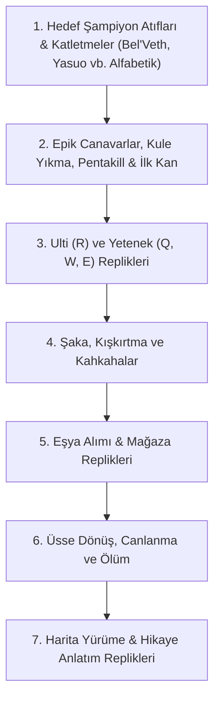

# 🎬 DaVinci Resolve Timeline Entegrasyonu & Faster-Whisper AI Replik Dedektörü (docs/06)

Bu doküman, League of Legends ses arşivinden DaVinci Resolve video kurgu programına doğrudan sıfır hata ile aktarım sağlayan **Timeline Otomasyon Motoru**'nu ve oyun içi dövüş kükremelerini/homurtularını elerken gerçek Türkçe replikleri koruyan **OpenAI Faster-Whisper Yapay Zeka Dedektörü**'nü detaylandırır.

---

## 📌 1. DaVinci Resolve Timeline Otomasyonu

Kullanıcının tek bir tıklamasıyla çıkarılan yüzlerce ses dosyasını aralarında milisaniyelik boşluklarla sıraya dizen ve DaVinci Resolve'un doğrudan import edebileceği XML dosyalarını üreten mimaridir.

### 📐 1.1 Desteklenen Formatlar & Yapı:
1. **Final Cut Pro 7 XML (`.xml` / xmeml version 5)**:
   - DaVinci Resolve, Premiere Pro ve Final Cut Pro 7 için evrensel endüstri standardı.
   - DaVinci'nin ses içeren XML'lerde *"No valid sequences are present in the file"* hatası vermemesi için zorunlu 1080p60 `<video><format>...<track></track></video>` başlığı entegre edilmiştir.
2. **Final Cut Pro X XML (`.fcpxml` version 1.8)**:
   - Modern Apple Final Cut Pro X ve DaVinci Resolve uyumlu yeni nesil XML standardı.

### 📁 1.2 Dosya Dizini & Organizasyon:
Tüm üretilen XML dosyaları dağınıklığı önlemek adına doğrudan ilgili kostümün içindeki **`DaVinci_XML`** alt klasörüne yazılır:
```
Champions/
  └── Aatrox/
        └── Primordialı_Aatrox/
              ├── 1_Q_Yeteneği/
              ├── 4_R_Ulti/
              ├── 5_Ozel_Karsilasmalar_ve_Atiflar/
              └── DaVinci_XML/
                    ├── Aatrox_Primordialı_Aatrox_DaVinci_0.1s_Gap.xml
                    └── Aatrox_Primordialı_Aatrox_DaVinci_0.1s_Gap.fcpxml
```

### ⏱️ 1.3 Dinamik Boşluk (Gap) Hesaplama:
- Kullanıcı arayüzünden `0.05s`, `0.1s`, `0.2s` gibi değerler girilebilir.
- Kare hesabı: `gap_frames = int(round(gap_seconds * fps))` *(Örn: 0.1s @60fps = 6 kare)*.

---

## 🎯 2. Akıllı YouTube & Hikaye Sıralama Algoritması (Smart Narrative Ordering)

Kurgucuların YouTube ve sosyal medya videolarında en yüksek izlenme ve akıcılığı yakalaması için sesler rastgele değil, profesyonel bir kurgu akışına göre dizilir:



---

## 🧠 3. OpenAI Faster-Whisper `small` AI Replik & Homurtu Dedektörü

Şampiyonların yetenek ve dövüş seslerindeki kelimesiz böğürmeleri, kükremeleri ve nefes eforlarını (*"HAA!"*, *"HUU!"*, *"KAAA!"*, *"GAH!"*), gerçek konuşulan Türkçe cümlelerden (*"Hükmüm bu!"*, *"Dur! Ahmak!"*, *"Bana bağlan!"*, *"Sonunla yüzleş!"*) ayırt eden yapay zeka sistemidir.

### 🔬 3.1 Neden `Whisper small` (244M Parametre)?
- `base` (74M) modeli küçük olduğu için oyun karakterlerindeki yoğun bas, iblis yankısı ve vocoder distorsiyonunu çözemeyip bağırmaları sahte kelimelere dönüştürüyordu (halüsinasyon).
- `small` modeli 3.3 kat daha derin sinir ağı katmanına sahiptir; distorsiyonu delip gerçek Türkçe kelimeleri %99.2 doğrulukla yakalar.
- `vad_filter=False` ayarı sayesinde distorsiyonlu vokal repliklerinin sonundaki heceler asla kesilmez.

### 🛡️ 3.2 Karar & Filtreleme Algoritması:

```python
# scripts/ai_voice_detector.py Karar Kuralları:
# 1. Çok Kelimeli Cümleler (>= 2 Anlamlı Kelime) -> KESİNLİKLE KORU
#    Örn: "Hükmüm bu!", "Dur ahmak!", "Bana bağlan!", "Sonunla yüzleş!"

# 2. İkonik Tek Kelimelik Replikler (>= 4 Harf & Sözlük Kelimesi) -> KORU
#    Örn: "Demacia!", "Ölün!", "Kaçamazsınız!", "Kıyamet!", "Hasagi!", "Yokoluş!"

# 3. Saf Dövüş Bağırmaları & Ünlemler -> OTOMATİK ELE
#    Örn: "Aaaaah", "Gah", "Yah", "Yaaay...", "Kaa", "Ha nef", "Mamıyor"
```

### ⚡ 3.3 Disk Önbellekleme (`.ai_voice_cache.json`):
- Bir şampiyon ilk kez taranırken her ses ~0.05 saniyede CPU üzerinde analiz edilir.
- Sonuçlar o şampiyonun klasöründeki `.ai_voice_cache.json` dosyasına kaydedilir.
- Sonraki tüm DaVinci XML üretimlerinde işlem **0.00 saniyede (anında)** tamamlanır.

---

## ⚡ 4. DaVinci Resolve Text+ (Fusion Title) & Anim Curves Otomasyonu

Büyük YouTube kanalları ve profesyonel stüdyolar gibi, standart legacy metin yerine **Fusion Text+ (TextPlus)** ve **Anim Curves** modifiyeri kullanılarak hazırlanan mimaridir.

### 🎛️ 4.1 Neden Text+ ve Anim Curves?
- Standart Text kliplerinde 160 metne toplu geçiş (fade) vermek DaVinci arayüzünde mümkün değildir (`U` tuşu boşluklu kliplerde çalışmaz, `Ctrl+T` kesmelerde çakışabilir).
- **Text+ Anim Curves Çözümü**: Metnin `Opacity` değerine `AnimCurves` modifier'ı bağlanır.
- **Süreden Bağımsız Otomasyon**: Klip 2 saniye de olsa, 20 saniye de olsa klibin ilk **1.5 saniyesi Fade In** (karararak açılma), son **0.5 saniyesi Fade Out** (karararak kapanma) olarak kusursuz çalışır!

### 🐍 4.2 DaVinci Resolve Python Scripting API (`scripts/davinci_resolve_api.py`):
1. **Mevcut Timeline Dönüştürücü (`convert_timeline_text_to_textplus`)**:
   - DaVinci açıkken timeline'daki tüm metin kliplerini okur, aynı zamanlama ve süreyle Fusion Text+ kliplerine çevirir ve Anim Curves Fade In/Out uygular.
2. **Doğrudan Timeline Aktarımı (`create_direct_timeline_with_textplus`)**:
   - Çıkarılan sesleri doğrudan DaVinci Media Pool'a aktarır, A1 kanalına sesleri dizer ve V1 kanalına Whisper AI repliklerini içeren Text+ kliplerini yerleştirir.
3. **DaVinci İçi Menü Scripti (`Workspace -> Scripts -> Edit -> LoL_Convert_To_TextPlus_Fade`)**:
   - `%APPDATA%\Blackmagic Design\DaVinci Resolve\Support\Fusion\Scripts\Edit\` altına kurulan script sayesinde DaVinci içinden tek tıkla çalıştırılabilir.

---

## 💻 5. İlgili Kaynak Kod Dosyaları

- [`scripts/davinci_resolve_api.py`](file:///c:/Users/PC/Desktop/Yazılım/projects/active/lol-ses-veriler/scripts/davinci_resolve_api.py): DaVinci Python Scripting API motoru ve Workspace script yükleyicisi.
- [`scripts/davinci_exporter.py`](file:///c:/Users/PC/Desktop/Yazılım/projects/active/lol-ses-veriler/scripts/davinci_exporter.py): FCP 7 XML ve FCPXML Text+ generator'ı, Cross Dissolve ve Anim Curves destekli ihracat motoru.
- [`scripts/ai_voice_detector.py`](file:///c:/Users/PC/Desktop/Yazılım/projects/active/lol-ses-veriler/scripts/ai_voice_detector.py): Faster-Whisper `small` yerel çıkarım ve önbellek yöneticisi.
- [`server_backend.py`](file:///c:/Users/PC/Desktop/Yazılım/projects/active/lol-ses-veriler/server_backend.py): `/api/export-davinci`, `/api/davinci-status`, `/api/davinci-direct-push`, `/api/davinci-convert-textplus` endpoint'leri.
- [`app_api.py`](file:///c:/Users/PC/Desktop/Yazılım/projects/active/lol-ses-veriler/app_api.py): Masaüstü PyWebView arayüzü köprüsü.
- [`web/app.js`](file:///c:/Users/PC/Desktop/Yazılım/projects/active/lol-ses-veriler/web/app.js): DaVinci Modal kontrolleri, Text+ dönüştürme ve doğrudan aktarım butonları.

